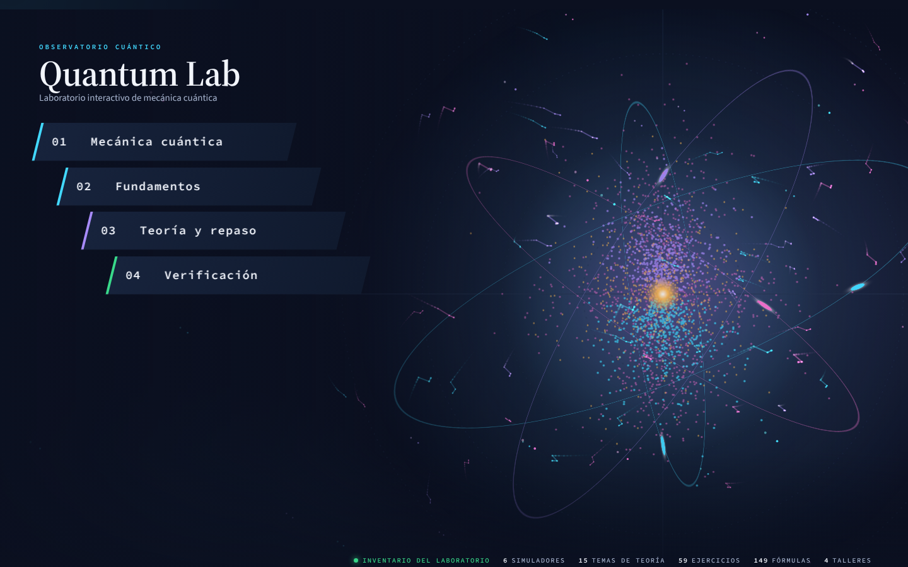
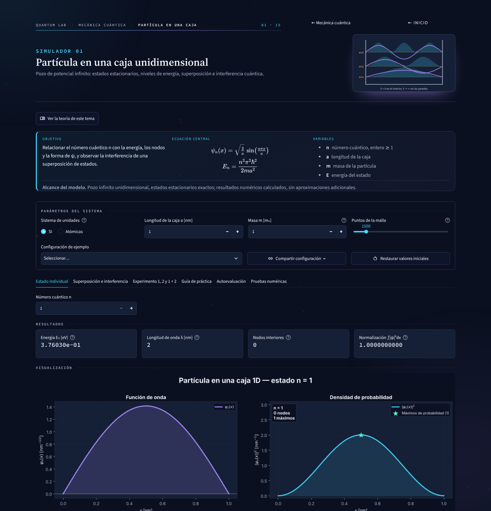
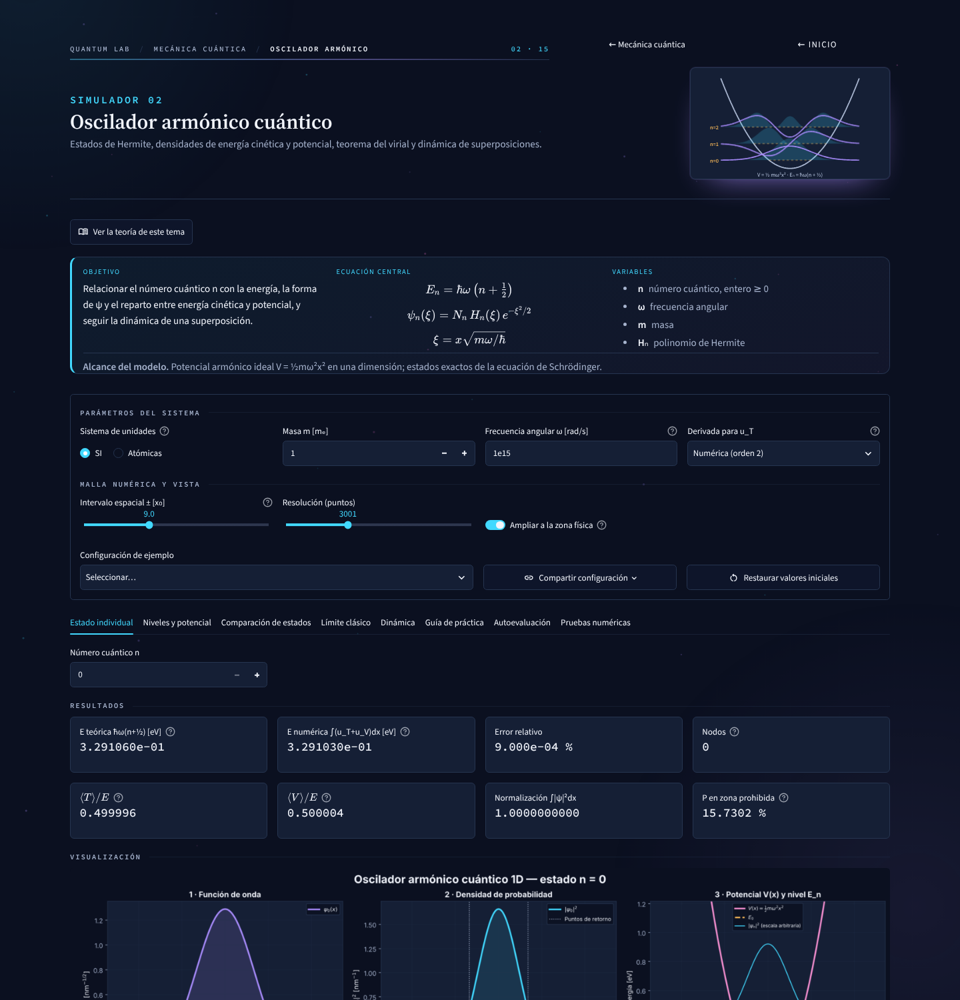
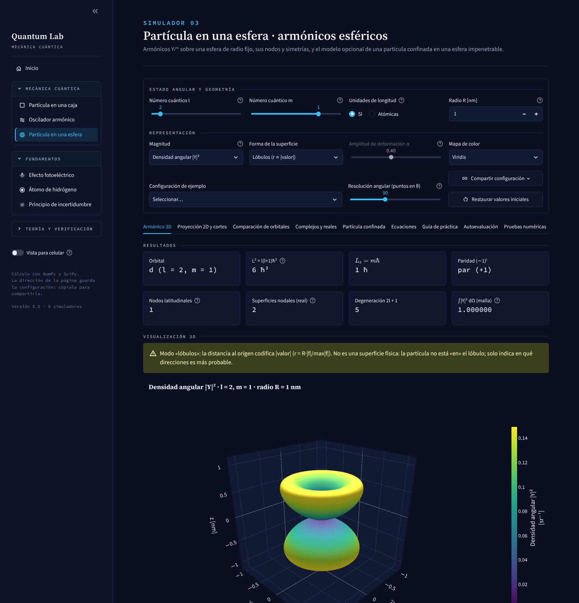
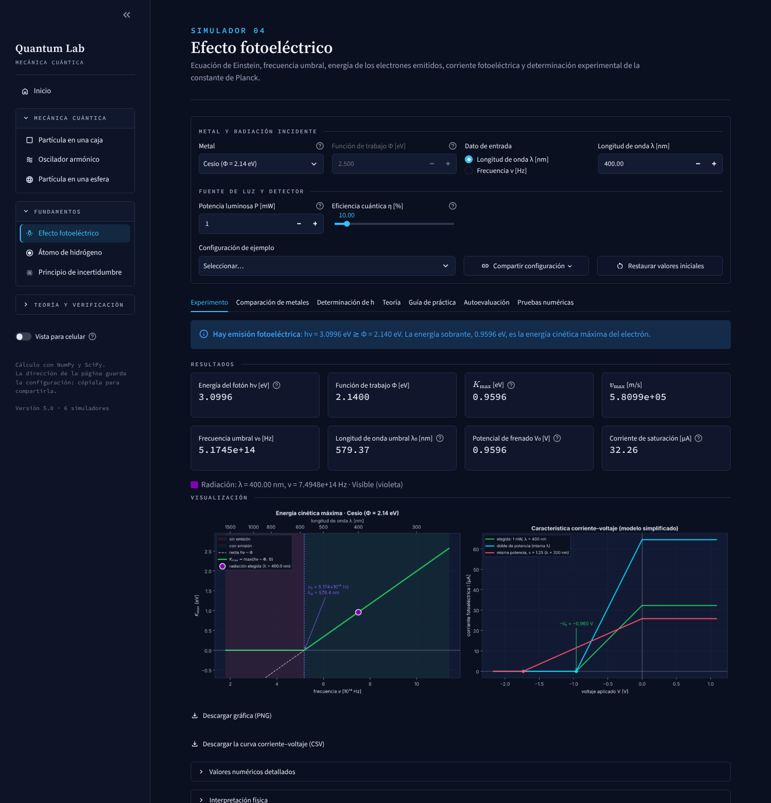
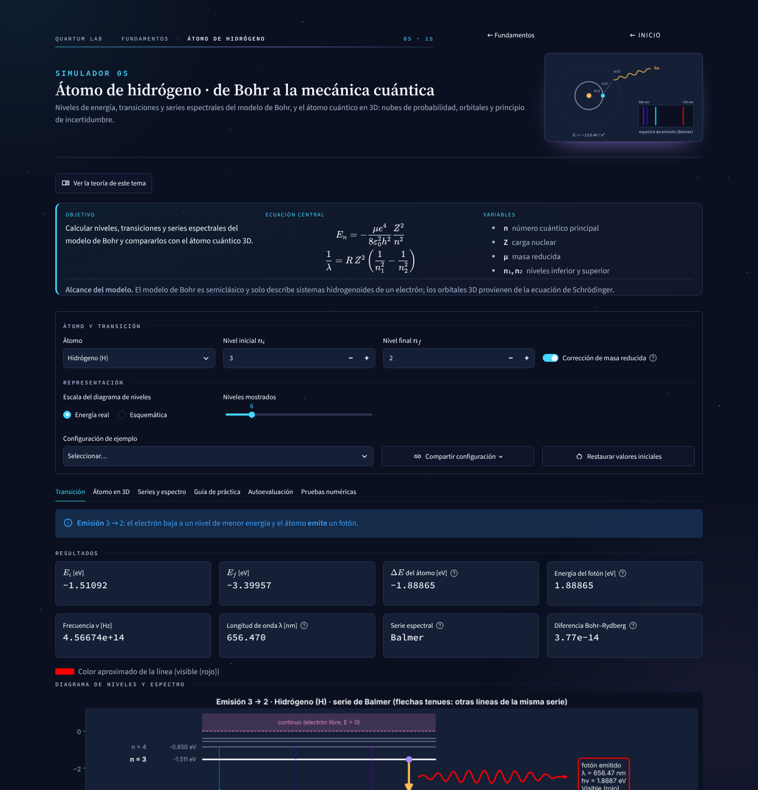
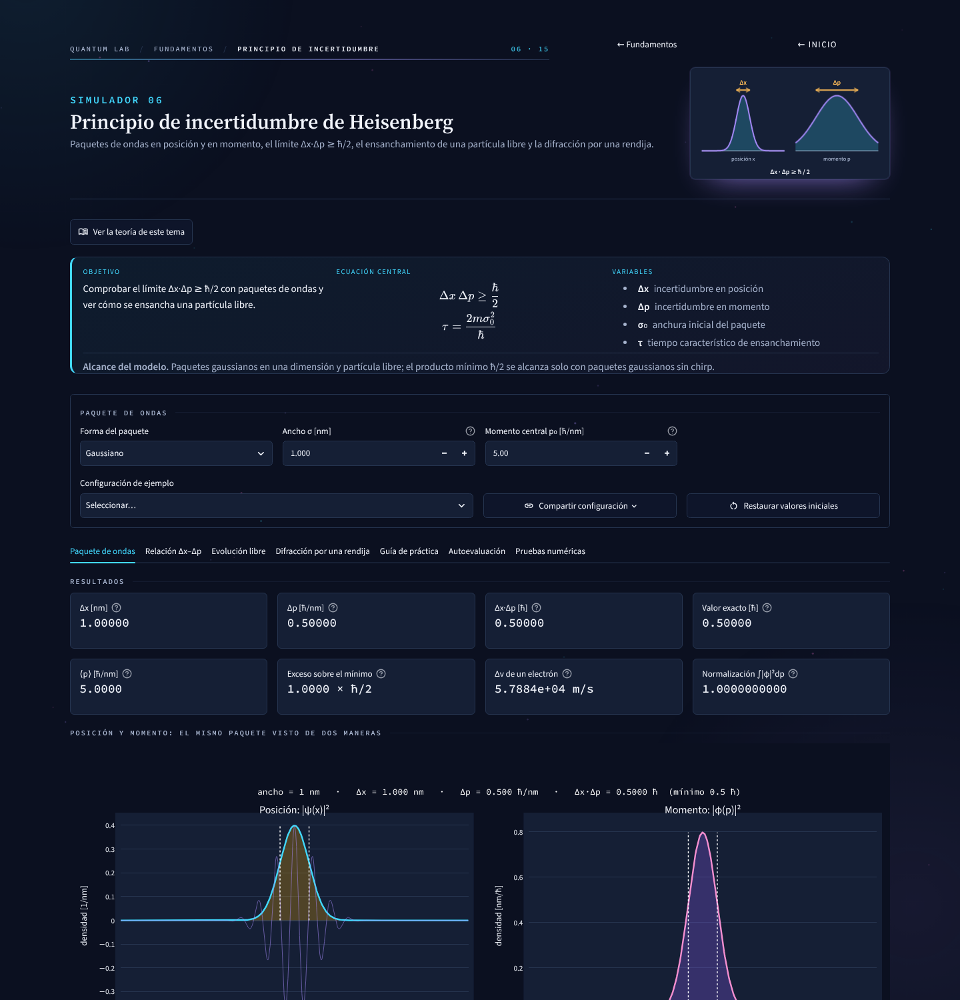
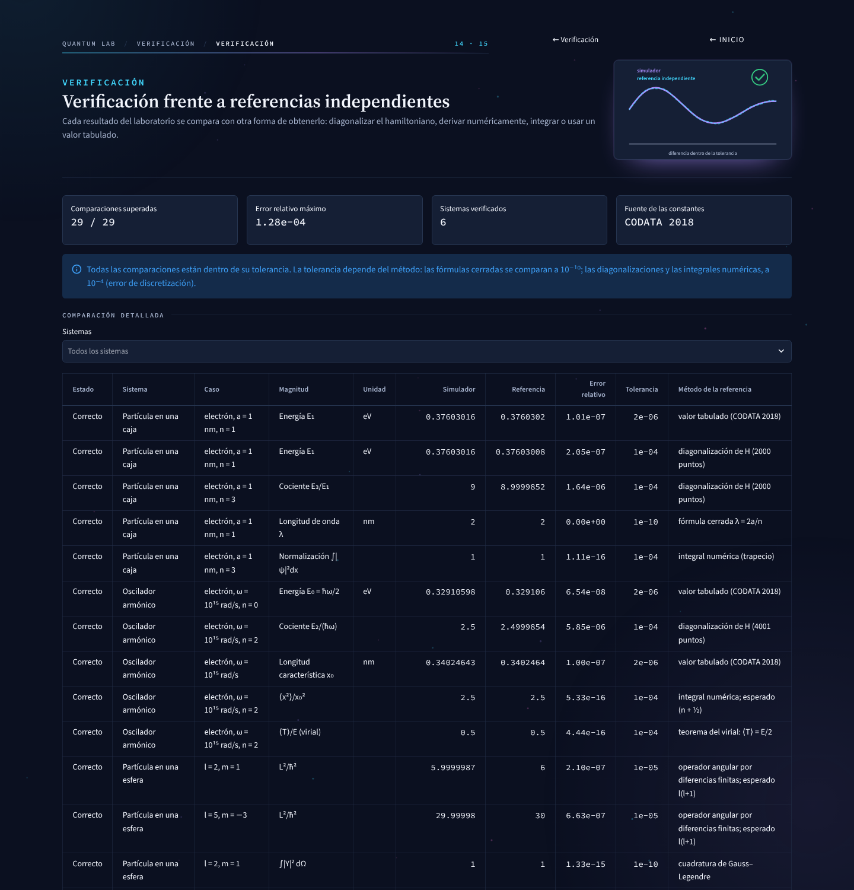

# QUANTUM LAB — Laboratorio interactivo de mecánica cuántica

[](https://github.com/xXITACHIXx/quantum-lab/actions/workflows/tests.yml)


Seis simuladores (más una página de verificación) con una identidad visual común (tema oscuro, tipografía científica sin emojis), todo en español.
Cada simulador incluye resultados numéricos, visualización, interpretación, ecuaciones o **teoría**, **guía de
práctica**, **autoevaluación** y **pruebas numéricas**. El cálculo se hace con NumPy y SciPy, sin APIs externas ni claves.

| Archivo | Contenido |
|---|---|
| `quantum_lab.py` | Aplicación principal: enruta las páginas (portada, sub-portadas por capítulo, simuladores, estudio, verificación), pie de página y pruebas globales. **No hay barra lateral** |
| `quantum_lab_portada.py` | Portada y sub-portadas: lista `MODULOS` (número, categoría, título, descripción y lema de cada destino), `CAPITULOS`, menú de barras angulares y escenario con la ilustración de cada elemento |
| `quantum_lab_escena.py` | Movimiento y escena: CSS de animaciones, JavaScript opcional (partículas, emergencia desde abajo, refresco de gráficas), fondo del átomo |
| `quantum_lab_arte.py` | Ilustraciones **conceptuales** en SVG (una por destino, el átomo de la portada y el observatorio); sin imágenes externas |
| `quantum_lab_tema.py` | Paleta única (colores, series, contraste) de la que salen el CSS, Matplotlib, Plotly y las ilustraciones |
| `fuente_simbolos.css` | Fuente de símbolos (subíndices, superíndices, operadores) incrustada y **pregenerada**: evita cuadros vacíos en celulares |
| `teoria/` | **Centro de teoría**: `__init__.py` (índice por unidades y temas) y un archivo por tema con su teoría, calculadoras y autoevaluación (`postulados.py`, `bohr.py`…); `_util.py` reúne las funciones comunes de figuras |
| `talleres/` | **Talleres de repaso**: `__init__.py` (índice, página y pruebas), `_calificar.py` (lectura de números y tolerancias), `_modelo.py` (preguntas y calificación por partes), `_fisica.py` (cálculos verificados) y un archivo por taller (`t1_espectros.py`…) |
| `biblioteca/`, `solucionador/`, `tutor/`, `guia/` | Herramientas de estudio: biblioteca científica, solucionador paso a paso, tutor de errores conceptuales y guía de usuario con diagramas de flujo (ver apartado 11) |
| `ruta/`, `formulario/`, `examen/`, `repaso/` | Ruta de estudio, formulario de constantes y fórmulas, modo examen y repaso personalizado (cada uno con su `__init__.py` y módulos de apoyo) |
| `ejercicios/` | **Ejercicios de práctica**: `__init__.py` (página, filtros y pruebas), `_modelo.py` (ejercicio, fuentes y temas), `_progreso.py`, `_figuras.py`, `_calidad.py` y los ejercicios por fuente: `clase_s1_s5.py`, `clase_s6_s13.py` (diapositivas), `libro.py` y `cuaderno.py` |
| `particula_caja.py` | 01 · Partícula en una caja 1D: ψₙ, Eₙ, De Broglie, nodos, **superposición e interferencia** |
| `oscilador_armonico.py` | 02 · Oscilador armónico: Hermite, densidades de energía, virial, **límite clásico**, dinámica |
| `particula_esfera.py` | 03 · Densidad de probabilidad |Yₗᵐ|² frente a la posición (x, y, z), armónicos esféricos en 3D, nodos, simetrías, complejos vs reales, partícula confinada |
| `efecto_fotoelectrico.py` | 04 · Efecto fotoeléctrico: Einstein, umbral, corriente, comparación de metales, **determinación de h**, teoría e historia |
| `modelo_bohr.py` | 05 · Átomo de hidrógeno: modelo de Bohr (transiciones, series, Rydberg, masa reducida) y **átomo cuántico en 3D** (nubes de probabilidad, orbitales, animación del salto), teoría |
| `principio_incertidumbre.py` | 06 · Principio de incertidumbre: paquetes de ondas en x y p, límite ħ/2, evolución libre, difracción por una rendija, teoría |
| `predice.py` | Modo **«Predice y experimenta»**: pregunta → predicción → experimento → comparación → explicación. La respuesta correcta se deduce del cálculo del simulador, no se escribe a mano |
| `inverso.py` | **Laboratorio inverso**: retos con un objetivo; clasifica el intento como exacto, aproximado o incorrecto con las mismas funciones del simulador |
| `instrumentos.py` | Instrumentos de lectura: cursor, probabilidad en un intervalo (con la integral exacta), fotón entre niveles y comparación |
| `informes.py` | **Informe de experimento** descargable en PDF y CSV (objetivo, modelo, parámetros, resultados, conclusiones) |
| `test_predice.py`, `test_mejoras.py` | Pruebas de predicción, retos inversos, instrumentos, informes y enlaces de estudio |
| `quantum_lab_comun.py` | Código compartido (constantes, unidades, estilo, componentes de interfaz, enlaces, descargas, guías, autoevaluación, pruebas). No contiene física de los simuladores |
| `verificacion.py` | Página «Verificación»: compara cada simulador con una referencia independiente (diagonalización del hamiltoniano, diferencias finitas, integrales, valores tabulados) |
| `test_quantum_lab.py` | Pruebas numéricas y de verificación con `pytest` |
| `test_interfaz.py` | Pruebas de interfaz (cada página se ejecuta con `AppTest` sin excepciones) |
| `test_escena.py`, `test_arte.py`, `test_tema.py`, `test_movil.py`, `test_caja_diseno.py` | Pruebas de la portada y la navegación, las ilustraciones, la paleta y el contraste, el celular y la accesibilidad (texto alternativo, fuente de símbolos, fondo estable) y la figura y la superposición de la caja |
| `test_herramientas.py` | Pruebas de biblioteca, solucionador y tutor |
| `test_esfera_densidad.py`, `test_colab.py` | Densidad |Yₗᵐ|² en coordenadas cartesianas (web) y ejecución de los cuadernos de Colab, con la densidad comparada con la web |
| `test_ruta.py`, `test_formulario.py`, `test_talleres.py`, `test_ejercicios*.py`, `test_examen.py`, `test_repaso.py`, `test_teoria.py` | Pruebas de las secciones de estudio |
| `requirements.txt` | Dependencias con límites de versión |
| `requirements-lock.txt` | Versiones exactas con las que se probó el proyecto |
| `colab/` | Los tres cuadernos de Google Colab (caja, oscilador, esfera): implementación independiente de la misma física, y `celda_superposicion_oscilador.py`, una celda suelta con la animación de la superposición de estados del oscilador |
| `docs/img/` | Capturas usadas en este README |
| `.github/workflows/tests.yml` | Integración continua: ejecuta `pytest` en cada subida y una vez por semana |
| `.github/dependabot.yml` | Avisos semanales de actualización de dependencias |
| `.streamlit/config.toml` | Tema visual (colores y tipografías Source Serif / Sans / Code incluidas en Streamlit) |

Los simuladores 04 y 05 proceden de los cuadernos «Efecto_Fotoelectrico_Simulacion.ipynb» y
«Modelo_Bohr_Simulacion.ipynb», adaptados a la interfaz interactiva y ampliados.

## Vista previa

Capturas de la interfaz actual (escritorio, 1440 px).

| | |
|---|---|
|  **Portada** |  **01 · Partícula en una caja** |
|  **02 · Oscilador armónico** |  **03 · Partícula en una esfera** |
|  **04 · Efecto fotoeléctrico** |  **05 · Átomo de hidrógeno** |
|  **06 · Principio de incertidumbre** |  **Verificación** |

---

## 1. Requisitos

* **Python 3.10 a 3.13** (recomendado **3.12**). Las versiones más nuevas (3.14, 3.15) todavía no tienen
  versiones compiladas de algunas dependencias de Streamlit y la instalación falla («Failed to build pyarrow»).
  Descárgalo de <https://www.python.org/downloads/windows/> y marca **«Add python.exe to PATH»**.
* Un navegador moderno (Chrome, Edge, Firefox).

## 2. Instalación en Windows (PowerShell o CMD) / VS Code

1. Descomprime la carpeta `quantum_lab`.
2. **VS Code:** `Archivo → Abrir carpeta…` y elige `quantum_lab`. Abre la terminal con `Ctrl + ñ`.
3. Crea y activa un entorno virtual con Python 3.12:

   ```powershell
   py -3.12 -m venv .venv312
   .\.venv312\Scripts\Activate.ps1
   python --version          # debe decir Python 3.12.x
   ```

   *Si PowerShell rechaza el script*, ejecuta una vez `Set-ExecutionPolicy -Scope CurrentUser RemoteSigned`.
4. Instala las dependencias:

   ```powershell
   python -m pip install --upgrade pip
   python -m pip install --only-binary=:all: -r requirements.txt
   ```

5. En VS Code: `Ctrl+Shift+P → Python: Select Interpreter → .venv312`.

**Linux / macOS:** `python3 -m venv .venv && source .venv/bin/activate && pip install -r requirements.txt`

## 3. Ejecución

```powershell
python -m streamlit run quantum_lab.py
```

Abre en el navegador <http://localhost:8501> (la aplicación no lo abre sola: ver la nota de abajo). Para cerrarla: `Ctrl + C` en la terminal.
Cada simulador también se puede lanzar por separado, p. ej. `python -m streamlit run modelo_bohr.py`.

> **Nota:** `.streamlit/config.toml` fija `headless = true`. Con `false`, Streamlit pide un correo por teclado la primera
> vez y, en un servidor sin teclado (Streamlit Cloud), se queda esperando y la aplicación **no arranca**. Si prefieres
> que el navegador se abra solo en tu ordenador, ejecuta `python -m streamlit run quantum_lab.py --server.headless false`.

### Publicación en la web (Streamlit Community Cloud)

Sube **todos** los archivos de la tabla (incluidas las carpetas `.streamlit`, `.github`, `colab` y `docs`) a un repositorio de GitHub y despliega
`quantum_lab.py` desde <https://share.streamlit.io> eligiendo **Python 3.12** en «Advanced settings». Para
actualizar la web basta con subir los archivos modificados: la aplicación se redespliega sola.

## 4. Pruebas y mantenimiento

```powershell
python -m pytest -q          # 905 pruebas: numéricas, verificación, interfaz y accesibilidad (varios minutos)
python -m pytest -q test_quantum_lab.py     # solo las numéricas (unos 8 s)
python quantum_lab.py        # lista todas las comprobaciones y su resultado
python modelo_bohr.py        # pruebas de un solo simulador
```

También hay un botón de pruebas en la pestaña **«Pruebas numéricas»** de cada simulador, en la página
**«Pruebas numéricas»** del menú y la página **«Verificación»** (ver el apartado 6).

**Integración continua.** El flujo `.github/workflows/tests.yml` ejecuta `pytest` en GitHub con Python 3.10, 3.12 y 3.13
cada vez que se sube un cambio y cada lunes, para detectar a tiempo si una versión nueva de una dependencia rompe algo.
La insignia de la parte superior de este archivo muestra el resultado. `dependabot.yml` propone cada semana las
actualizaciones de dependencias.

**Versiones.** `requirements.txt` fija solo límites (por ejemplo `streamlit>=1.65,<2`) para que una versión mayor
futura no rompa la aplicación sin aviso; las versiones exactas probadas están en `requirements-lock.txt`
(`python -m pip install -r requirements-lock.txt` reproduce ese entorno). Al actualizar la versión publicada en
Streamlit Cloud hay que pulsar **«Reboot app»** (la nube conserva en memoria los módulos ya importados) y comprobar en
el pie de la página que aparece el número de versión esperado (ahora 6.0).

## 5. Uso

* **Centro de teoría** (inicio → capítulo «Teoría y repaso»): toda la teoría del curso en un solo lugar, organizada
  por unidades según las diapositivas. Los temas sin material aún aparecen como «en preparación». Cada tema
  tiene pestañas de *Teoría* (con calculadoras y gráficas interactivas), *Simulación y práctica* (cuando hay simulador)
  y *Autoevaluación*. Desde cada simulador, «Ver la teoría de este tema» abre su explicación. Un tema se enlaza con
  `?sim=teoria&tema=bohr`.
* **Talleres de repaso** (inicio → capítulo «Teoría y repaso»): problemas al estilo de los talleres del curso. Se escriben los
  resultados (acepta `1.256e12` y `1,256 x 10^12`), cada pregunta se califica por partes con una tolerancia del 2 %, se
  señala el error típico (factor 2π, unidades, signo…) y se muestra la solución justificada. Con «Datos nuevos» cada
  intento cambia los valores. Un taller se enlaza con `?sim=talleres&taller=espectros`.
* **Añadir un taller:** crear `talleres/tN_<tema>.py` con una función `construir(datos)` que devuelva sus `Pregunta` y un
  `TALLER = Taller(...)`, y añadirlo a `TALLERES` en `talleres/__init__.py`. Las pruebas comprueban que las respuestas
  correctas obtienen el puntaje completo en todas las variantes.
* **Ejercicios de práctica** (inicio → capítulo «Teoría y repaso»): 59 ejercicios, los *Example Problems* y *Classwork* de las
  diapositivas y los ejercicios del libro trabajados en el cuaderno. Se filtran por fuente, tema o texto; cada uno tiene
  pistas y una **solución paso a paso** que se puede abrir sin responder, y las partes numéricas o de opción se pueden
  comprobar con el mismo calificador de los talleres. Las erratas encontradas en las fuentes se señalan en la nota del
  ejercicio. Un ejercicio se enlaza con `?sim=ejercicios&ej=s9_nodos`.
* **Progreso guardado:** acertar un ejercicio (o marcar «Ya lo resolví») lo cuenta en «Mi progreso». El progreso viaja en la
  dirección de la página (parámetro `prog`, 4 caracteres por ejercicio, estable aunque se añadan o reordenen ejercicios):
  guardar la página en favoritos o copiar el enlace basta para continuar después. «Copia de seguridad de mi progreso»
  descarga/carga un JSON. No hay cuentas ni servidor. «Siguiente sin resolver» salta a lo que falta.
* **Gráficas interactivas:** 8 ejercicios traen una gráfica bajo la solución (nodos del oscilador con deslizador de *n*, conos
  de momento angular, funciones radiales 3s y 4d, orbital 2pz, lóbulos de Y₂⁰, probabilidad en la caja). Están en
  `ejercicios/_figuras.py`, que las asocia al id del ejercicio.
* **Añadir un ejercicio:** escribir una función que devuelva un `Ejercicio(...)` en el archivo de su fuente (`ejercicios/`)
  y añadirla a la tupla `EJERCICIOS` de ese archivo. Reglas que exigen las pruebas (`ejercicios/_calidad.py`): id en
  minúsculas con prefijo según la fuente (`s<semana>_`, `l<N>_`/`h<N>_`, `c_`), referencia que empiece por «Semana», «Libro»
  o «Cuaderno», al menos una pista, la solución con pasos numerados `#### Paso 1 · …` (mínimo 3), sin `$` sueltos ni
  `<<plantillas>>` sin rellenar. Para añadir una gráfica, registrar una `Figura` en `FIGURAS` de `_figuras.py`.
* **Revisión antes de publicar:** `python -m ejercicios` imprime el informe de mantenimiento (cuántos ejercicios hay por
  fuente, semana y tema, reglas de calidad y contrastes numéricos) y termina con error si algo falla.
* **Identidad visual:** la paleta vive en un solo archivo, `quantum_lab_tema.py` (fondo #0B1020, paneles #151F35, cian #42D9FF para controles y densidad
  |ψ|², violeta #A78BFA para funciones de onda y orbitales, verde para validaciones y energía cinética, amarillo para energía y advertencias, rojo para
  errores). De ahí salen el CSS, los gráficos de Matplotlib y Plotly y las ilustraciones; `.streamlit/config.toml` repite los valores base y
  `test_tema.py` comprueba que coincidan y que el contraste sea de al menos 4.5:1. Las ilustraciones de la portada y de cada simulador son SVG
  **conceptuales** generados en `quantum_lab_arte.py` (sin imágenes externas ni conexión); no son resultados del simulador. La portada y sus tarjetas
  están en `quantum_lab_portada.py` (lista `MODULOS`: número, categoría, título y descripción de cada módulo).
* **Escena y movimiento** (`quantum_lab_escena.py`): (1) *navegación animada*: cada página se dibuja en `st.container(key="ql_escena_<página>")`;
  como la clave solo cambia al navegar, la entrada escalonada, el barrido de la barra de ubicación y el trazado de la ilustración se reproducen
  al cambiar de página y no al mover un control; la barra de ubicación indica categoría, página y número, con regreso al capítulo y al inicio.
  (2) *Destinos interactivos*: cada tarjeta de la portada es un contenedor `ql_dest_<página>` con un `st.button` real extendido sobre toda
  la tarjeta (clic, toque y teclado); al pasar el cursor se eleva, se enciende la línea de energía, la luz sigue al puntero y la ilustración se
  vuelve a trazar. (3) *Portada*: átomo a pantalla completa (ver el apartado 10); el «observatorio» por capas de la versión anterior se conserva en el código
  (`observatorio_html`) pero ya no se muestra. Los indicadores de los simuladores destellan cuando su valor cambia. El JavaScript es una mejora progresiva (`st.html` con
  `unsafe_allow_javascript`, detectado en tiempo de ejecución); sin él quedan todas las animaciones CSS. Con `prefers-reduced-motion` todo se
  detiene, y en móviles se suprimen el plano y las partículas.
* **Ruta de estudio** (inicio → capítulo «Teoría y repaso»): recorrido por dominio de cada tema, sin depender de fechas. Los 13 temas siguen un orden de
  dependencias físicas (`ORDEN` y `PREREQ` en `ejercicios/_ruta.py`). Cada tema tiene tres pasos: *teoría leída* (se marca a mano; no aplica si la
  teoría aún no existe), *ejercicios resueltos* (al menos el 75 %) y *mini-examen aprobado* (3 ejercicios del tema, nota de 3.0 o más sobre 5.0).
  Avisa de los prerrequisitos incompletos o con precisión menor de 60 % y propone el «Siguiente paso»: primero el tema de bajo desempeño y, si no hay,
  el primer tema pendiente con prerrequisitos cumplidos. También aparece en el inicio. Las marcas viajan en la dirección (parámetro `rut`) y en la
  copia de seguridad.
* **Formulario** (inicio → capítulo «Teoría y repaso»): constantes fundamentales con valor CODATA e incertidumbre relativa (las del SI
  exactas), unidades atómicas, combinaciones frecuentes (hc, ħc, e²/4πε₀, k_BT…), conversor de energía (J, eV, hartree, cm⁻¹, Hz, nm, kJ/mol,
  kcal/mol, K) con región espectral, conversores de longitud, masa y ángulo, 149 fórmulas agrupadas en 18 temas (con definición de símbolos y
  condiciones de validez, buscador y enlaces a la teoría y a los ejercicios del tema), masas isotópicas (AME2020) y calculadora de masa reducida.
  Se descarga completo en Markdown. Cada fórmula con resultado numérico lleva un **contraste** (valor calculado frente a una referencia
  independiente) que verifican las pruebas. Añadir una fórmula: `F(nombre, latex, nota, contraste)` en `formulario/_formulas_a.py` o `_formulas_b.py`.
* **Modo examen:** evaluación cronometrada con ejercicios elegidos al azar según fuente, tema y nivel (o solo los pendientes de repaso). No se muestran
  pistas ni soluciones durante la prueba; al entregar (o al agotarse el tiempo) se califica sobre 5.0 con crédito parcial y se muestra la corrección.
  Una semilla opcional reproduce el mismo examen. El historial de exámenes se guarda en la copia de seguridad.
* **Repaso personalizado:** a partir de las comprobaciones y los exámenes, lista los ejercicios por repasar, los temas con menor precisión y los
  errores más frecuentes detectados por el calificador, con enlaces al ejercicio y a la teoría, y permite armar un examen con los pendientes.
* **Vocabulario:** los textos de la web usan un registro académico e impersonal (infinitivos o formas impersonales, sin segunda persona).
* **Añadir un tema nuevo:** crear `teoria/<id>.py` con una función `mostrar()` (y, opcionalmente, una lista `PREGUNTAS`) y
  registrarlo en la lista `UNIDADES` de `teoria/__init__.py` (las instrucciones están en la cabecera de ese archivo).
* Los **parámetros** están arriba de cada simulador; los resultados se recalculan al instante.
* «Configuración de ejemplo» carga casos típicos; «Restaurar valores iniciales» vuelve al principio.
* **Compartir configuración:** la dirección de la página guarda el simulador y los parámetros que difieren de los
  valores iniciales (p. ej. `?sim=bohr&bohr_ni=4`). El botón «Compartir configuración» muestra el enlace listo para
  copiar; al abrirlo se reproduce exactamente la misma configuración. Los parámetros no válidos se ignoran.
* **Descargas:** debajo de cada gráfica y tabla hay un botón para descargarla: PNG (gráficas estáticas), HTML
  interactivo (gráficas 3D y animaciones) o CSV (tablas; se abre en Excel con tildes y símbolos correctos).
* **Exportar los datos de las gráficas:** además de la imagen, los simuladores 01 (estado y superposición), 02
  (estado), 03 (|Y|² con x, y, z sobre la esfera), 04 (curva I–V) y 06 (|ψ(x)|² y |φ(p)|²) ofrecen un CSV con los
  números que dibujan la curva, en unidades SI y con el nombre y la unidad en la cabecera de cada columna. Los
  números complejos se separan en parte real e imaginaria.
* **Superposición en la caja:** el usuario indica cuántos estados superponer (hasta 20), cuáles (número cuántico n de cada uno) y sus coeficientes,
  escritos con el valor exacto: amplitud y fase, o parte real e imaginaria (la amplitud puede ser mayor que 1 si no se normaliza). La
  **«Lista rápida»** admite hasta 200 estados con el formato `n:A` o `n:A:φ` separados por «;» (por ejemplo `1:1; 2:0.5; 7:-0.3; 12:0.2:1.57`).
* **Vista para celular:** se activa sola al abrir la página desde un teléfono (también hay un interruptor en el
  pie de la página). Muestra 2 indicadores por fila y apila los paneles de las gráficas en una columna.
* **Guía de práctica:** experimentos con objetivo, procedimiento, una pregunta para predecir, un botón que carga la
  configuración y el resultado esperado oculto. El cuadro de texto sirve para anotar predicciones y medidas.
* **Autoevaluación:** preguntas de opción múltiple con corrección, puntuación y explicación de cada respuesta.
* **Animaciones** (caja, oscilador, átomo de hidrógeno, incertidumbre): botones «Reproducir» / «Pausa» y deslizador;
  se ejecutan en el navegador.
* Los gráficos 3D se **rotan con el ratón**, se amplían con la rueda y se restablecen con doble clic.
* Si introduces un valor no válido aparece un mensaje en rojo que explica el problema; la aplicación no se cae.

## 6. Verificación y contraste con Google Colab

La página **Verificación** (inicio → capítulo «Verificación») compara cada resultado con **otra forma de obtenerlo**, no
con la misma fórmula:

| Sistema | Se compara con |
|---|---|
| Caja y oscilador | Autovalores del hamiltoniano discretizado (`scipy.linalg.eigh_tridiagonal`), integrales y teorema del virial |
| Esfera | El operador angular L² aplicado a Yₗᵐ con diferencias finitas; normalización y ortogonalidad por cuadratura de Gauss–Legendre; ceros de j_l |
| Fotoeléctrico y Bohr | Valores tabulados (CODATA 2018), fórmula de Rydberg con masa reducida y ⟨r⟩ por integración numérica |
| Incertidumbre | El valor exacto de Δx·Δp de cada tipo de paquete (ħ/2, ½√(1+β²)ħ, √0.3 ħ, πħ/6) |

Cada fila muestra el valor del simulador, la referencia, el error relativo y su tolerancia, y la tabla se descarga
en CSV. Son 29 comparaciones; también se ejecutan con `pytest`.

**Contraste con los notebooks de Colab.** Los cuadernos de `colab/` son una implementación independiente de la misma
física. Con los mismos parámetros, las cifras que ambos muestran deben coincidir:

| Sistema | Parámetros | Resultado esperado |
|---|---|---|
| Caja 1D | electrón, L = 1 nm, n = 1 | E₁ = 0.37603 eV, λ = 2 nm |
| Oscilador | electrón, ω = 10¹⁵ rad/s, n = 0 | ħω = 0.658212 eV, E₀ = 0.329106 eV, x₀ = 0.340246 nm |
| Esfera | l = 2, m = 1 (orbital complejo) | L² = 6ħ², L_z = 1ħ |

Valores iniciales comunes: caja con a = 1 nm, masa 1 mₑ y n = 1; oscilador con masa 1 mₑ, ω = 10¹⁵ rad/s y n = 0;
esfera con R = 1 nm, l = 2, m = 1, orbital **complejo**, densidad |Y|², «lóbulos», α = 0.4 y 90 puntos en θ.

Diferencias que **no** son errores: la web limita algunos rangos (n ≤ 200 en la caja, l ≤ 20 en la esfera) y rechaza lo
que se sale, mientras que los notebooks aceptan cualquier valor y explican su validez física; la web usa tema oscuro
y los notebooks fondo claro. En la esfera, un orbital **real** (pₓ, d_xy…) no tiene L_z definido (mezcla m y −m);
el orbital **complejo** sí (L_z = mħ).

## 7. Qué se calcula y cómo se comprueba

* **Caja:** ψₙ = √(2/a) sin(nπx/a), Eₙ = n²π²ħ²/2ma², λ = 2a/n. Superposición Ψ = Σ cₙψₙe^{−iEₙt/ħ} con
  ρ = |Ψ|² **desde la onda total** (con la lista rápida, hasta 200 estados). 41 pruebas.
* **Oscilador:** ψₙ con polinomios de Hermite; energía ∫(u_T+u_V)dx contra ħω(n+½), virial, nodos, zona prohibida,
  orden de convergencia. **Límite clásico:** P_cl(x) = 1/(π√(A²−x²)) con A = √(2n+1)x₀; se comparan las
  probabilidades acumuladas (distancia D, que disminuye con n) y ⟨x²⟩ (idéntico). 34 pruebas.
* **Esfera:** Yₗᵐ calibrados contra fórmulas cerradas (Condon–Shortley), normalización de Gauss–Legendre,
  simetrías, nodos, ceros de Bessel. 65 pruebas.
* **Efecto fotoeléctrico:** K_max = hν − Φ, umbral ν₀ = Φ/h, v_max, potencial de frenado; corriente ∝ potencia
  (la intensidad no cambia K_max); característica I–V simplificada; ajuste de Millikan de V₀ frente a ν con las
  líneas del mercurio (recupera h y Φ; con ruido, la incertidumbre del ajuste es coherente). 29 pruebas.
* **Bohr:** Eₙ = −Z²·13.6057 eV/n², rₙ = n²a₀/Z, vₙ = Zαc/n; transición, fotón, serie (la fija el nivel más bajo) y
  región espectral; comparación con Rydberg: sin masa reducida difieren en mₑ/M ≈ 5.4×10⁻⁴, con ella coinciden.
  Hα = 656.47 nm, Lyman α = 121.57 nm, límite de Balmer = 364.71 nm (en el vacío). **Átomo cuántico:** R_nl con
  polinomios de Laguerre (normalización, ecuación radial, nodos n − l − 1, ⟨r⟩ exacto, radio más probable = n²a₀ si
  l = n − 1); la nube son medidas simuladas por muestreo exacto de |ψ|² (media de Monte Carlo dentro de 4σ);
  Δx·Δpₓ = ħ/√3 en el 1s. 36 pruebas.
* **Incertidumbre:** Δx y Δp numéricos (FFT, comprobados también con la derivada) frente a las fórmulas cerradas:
  gaussiano ħ/2, chirp ½√(1+β²)ħ, triangular √0.3 ħ, sech πħ/6, dos gaussianas con solapamiento; Parseval;
  evolución libre exacta (σ(τ) = √2σ₀, enfoque del chirp negativo, Δp y norma constantes, velocidad de grupo);
  rendija: sinc² contra suma de ondas de Huygens y primer mínimo en sen θ = λ/a. 32 pruebas.

## 8. Limitaciones científicas

* Herramienta **educativa** con modelos de una partícula, sin espín ni interacciones. El modelo de Bohr reproduce
  el espectro del hidrógeno pero no es la descripción moderna (no hay órbitas definidas) y no sirve para átomos de
  varios electrones; tampoco incluye la estructura fina.
* Las integrales y derivadas son **numéricas**; los errores se muestran en pantalla.
* Las funciones de trabajo del efecto fotoeléctrico son valores aproximados (dependen de la superficie). La curva
  corriente–voltaje usa un modelo simplificado.
* Las longitudes de onda del modelo de Bohr son **en el vacío** (en aire Hα mide 656.28 nm).
* La nube de probabilidad 3D muestra posiciones simuladas; los colores indican el signo (orbitales reales) o la fase
  (complejos) de ψ. La animación de las órbitas de Bohr tiene los radios a escala, pero no las velocidades.
* En la difracción por una rendija, Δp_y ≈ h/a es una estimación con el ancho del máximo central (la desviación
  típica de una rendija de bordes netos no es finita).
* Los colores de las líneas espectrales son una aproximación visual, no una conversión colorimétrica exacta.
* En la esfera, «deformación suave» y «lóbulos» son representaciones geométricas, no formas físicas.

## 9. Solución de problemas

| Problema | Solución |
|---|---|
| `Failed to build 'pyarrow'` al instalar | Tu Python es demasiado nuevo: instala Python 3.12 y crea el entorno con `py -3.12 -m venv .venv312` |
| «No se encontró Python» | Python no está instalado o no está en PATH: reinstálalo marcando «Add python.exe to PATH» y reinicia VS Code |
| `streamlit` no se reconoce | `python -m streamlit run quantum_lab.py` |
| `ModuleNotFoundError: numpy` | Activa el entorno virtual e instala `requirements.txt` |
| El puerto 8501 está ocupado | `python -m streamlit run quantum_lab.py --server.port 8502` |
| Gráficos lentos | Reduce la resolución angular (esfera), los puntos (caja/oscilador) o el número de medidas (nube 3D) |
| En Streamlit Cloud la app no arranca y el registro termina en «Welcome to Streamlit!» | Comprueba que `.streamlit/config.toml` tenga `headless = true` (con `false` se queda esperando un correo por teclado) |
| Se ve el diseño antiguo o un aviso sobre `theme` | `python -m pip install -U -r requirements.txt` (Streamlit 1.65 o superior) y reinicia |
| Símbolos como ₙ o ⟨⟩ salen como recuadros | La app incrusta una fuente de símbolos (`fuente_simbolos.css`); si persiste, recarga la página sin caché (`Ctrl + F5`). Para regenerar la fuente: `python -c "import quantum_lab_comun as q; open('fuente_simbolos.css','w',encoding='utf-8').write(q._generar_css_fuente())"` |

## 10. Portada, navegación y accesibilidad

**Navegación.** No hay barra lateral. La **portada** es un átomo ilustrado a pantalla completa (nubes de probabilidad muestreadas de densidades
hidrogenoides 1s, 2p y 3d, núcleo y órbitas de referencia, con partículas que lo orbitan) y, encima, los **cinco capítulos** como barras
angulares en escalera: Mecánica cuántica, Fundamentos, Teoría y repaso, Herramientas de estudio y Verificación. Al apuntar una barra (cursor o teclado) aparece, abajo a la
derecha, la ilustración conceptual del capítulo. Cada capítulo abre una **sub-portada** con sus temas en el mismo estilo, y cada tema, su página.
La transición es una emergencia desde abajo (un horizonte que sube con el título y vuelve a bajar al cargar la página). En todas las páginas, la
barra de ubicación de arriba tiene «← capítulo» y «← Inicio». Debajo de la primera pantalla de la portada están el siguiente paso sugerido, el
interruptor «Ver también los destinos como tarjetas» y las ayudas. Cada barra es un `st.button` real (clic, toque y Enter), así que la navegación
funciona también sin JavaScript. En pantallas menores de 900 px solo queda la lista sobre el fondo, y con movimiento reducido no hay animaciones.

**Gráficas.** Cada gráfica estática lleva **texto alternativo** construido solo con lo que la figura ya contiene (título y ejes de cada panel;
`quantum_lab_comun.descripcion_figura`). Cuando el usuario mueve un control y la gráfica se reemplaza, hace un fundido breve; no se animan resultados
ni se inventan datos.

**Interpretación propia.** El menú cinético, el átomo y las ilustraciones son una interpretación propia del lenguaje de menús cinéticos y del diseño
científico: no reproducen el diseño de ningún juego ni son resultados del simulador (las escalas de cada nube se ajustan para componer la imagen).

**Accesibilidad verificada.** Con axe-core (WCAG 2 A y AA) la caja, el oscilador, el átomo de hidrógeno y las tres herramientas de estudio (escritorio y Pixel 7 emulado) no tienen incumplimientos. Los botones primarios usan texto oscuro sobre el cian (antes blanco, contraste 1.7:1) y las ecuaciones más anchas que la pantalla reciben foco de teclado. Quedan avisos
menores de «regiones» (landmarks) que dependen de la estructura de Streamlit. Probado en Chromium (escritorio y un Pixel 7 emulado); no se ha
probado en Safari ni en un teléfono real.

**Pendiente.** Teoría de hidrógeno, espín y aproximados; simulador de orbitales; rediseño interior de los simuladores con la plantilla de diez
secciones (por ahora solo la ficha de entrada); las gráficas de Plotly se redibujan sin transición al mover un control.

## 11. Herramientas de estudio

Capítulo 04 de la portada, con cuatro páginas (pruebas en `test_herramientas.py`, `test_guia.py` y en las pruebas globales de la aplicación).

* **Biblioteca científica** (`biblioteca/`): glosario de 48 conceptos con definición, ecuación, advertencia de error frecuente y enlaces a la
  teoría y al simulador; 9 derivaciones paso a paso que terminan con una **comprobación numérica** (el código del laboratorio frente a una
  referencia calculada por otra vía); mapa de conexiones entre conceptos (37 relaciones, con grafo) y 16 referencias. Búsqueda unificada con el formulario.
  Añadir un término: `T(...)` en `biblioteca/_glosario.py`.
* **Solucionador paso a paso** (`solucionador/`): fotoeléctrico, caja, oscilador, transición de Bohr/Rydberg, De Broglie e incertidumbre.
  Muestra ecuaciones, datos, sustitución numérica con unidades, resultado e interpretación física. Los resultados se comparan en las pruebas con
  las funciones de los simuladores. Admite notación científica y rechaza datos inválidos con un mensaje.
* **Tutor de errores conceptuales** (`tutor/`): 22 confusiones frecuentes (amplitud con probabilidad, intensidad con energía del fotón,
  estacionario con reposo…). Dos entradas: un texto libre revisado por un detector **basado en reglas** (solo reconoce formulaciones típicas; que no
  encuentre nada no prueba que la explicación sea correcta) y 19 preguntas de diagnóstico cuyos distractores corresponden a una confusión; al fallar
  se da primero una pista y luego la explicación. El progreso vive solo en la sesión.
* **Guía de usuario** (`guia/`): diagramas de flujo de la ruta de un cálculo en la web, de las seis celdas de los cuadernos de Colab y de cada
  simulador (caja, oscilador y esfera), con una rama de error en el paso de validación y una fila «Para recordar». Cada paso cita las funciones
  que lo hacen en la web y en Colab, y las pruebas comprueban que existan. Cada diagrama se puede copiar en sintaxis Mermaid para editarlo en
  mermaid.live o draw.io. Añadir un diagrama: un `Diagrama` en `guia/_flujos.py`.

**Ideas adoptadas de referencias** (el diseño y el código son propios): de PhET (Quantum Bound States, Quantum Tunneling and Wave Packets, Photoelectric
Effect), varias representaciones de un mismo concepto, objetivos explícitos y confusiones típicas como la de intensidad con energía del fotón; de Quantum
Composer, el enlace entre conceptos (mapa de conexiones); de la documentación de Streamlit, `st.session_state`, claves únicas de widgets y `AppTest`.

## 12. Criterios del curso y dónde se cumplen

| Criterio | Web | Colab |
|:--|:--|:--|
| Densidad de probabilidad (armónicos esféricos) frente a la posición en coordenadas cartesianas, para cualquier estado; el usuario da l y mₗ | Esfera → pestaña **Densidad de probabilidad**: esfera de radio R coloreada por \|Y\|²/R² en x, y, z; superficie polar r = \|Y\|²; cortes xz, yz, xy; \|Y\|² frente a z; evaluación en un punto (x, y, z) | `QUANTUM_LAB_particula_esfera_colab.ipynb` → panel «Estado de la partícula» (l, mₗ) y pestaña **Densidad de probabilidad** |
| Oscilador: ψ, densidad de probabilidad, densidad de energía cinética, densidad de energía potencial y energía frente a x, para cualquier n | Oscilador → **Estado individual** (seis paneles con el mismo eje x) | Oscilador → **Estado individual** |
| Caja de longitud a: ψ, densidad de probabilidad y energía frente a x, para cualquier n y a | Caja → **Estado individual** | Caja → **Estado individual** |
| Caja: superposición e interferencia; el usuario indica cuántos estados, cuáles y sus coeficientes | Caja → **Superposición e interferencia** (tabla o lista n:coeficiente) | Caja → **Superposición** (número de filas, n, amplitud y fase, o lista) |

Para un estado complejo Yₗᵐ, |Y|² depende solo de z/R = cos θ (simetría axial); los orbitales reales (pₓ, d_xy…) mezclan +mₗ y −mₗ
y sí dependen de x e y. Cada cuaderno declara al principio los criterios que cumple.
